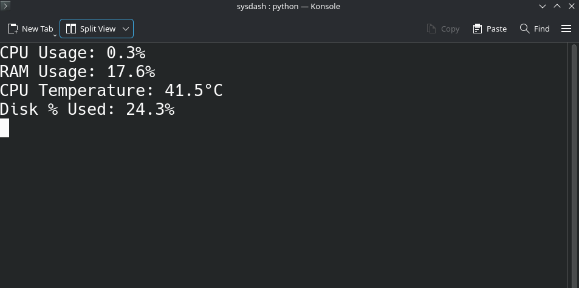

# sysdash: A simple system statistics dashboard

## It shows:
- CPU usage
- RAM usage
- CPU temperature
- Disk usage



## Current requirements:
- Linux
- AMD Ryzen CPU (for temperature reading)
- Python 3

## How to run:
```
git clone https://github.com/olidunne/sysdash.git
cd sysdash
python -m venv .venv
source .venv/bin/activate
pip install psutil
python sysdash.py
```